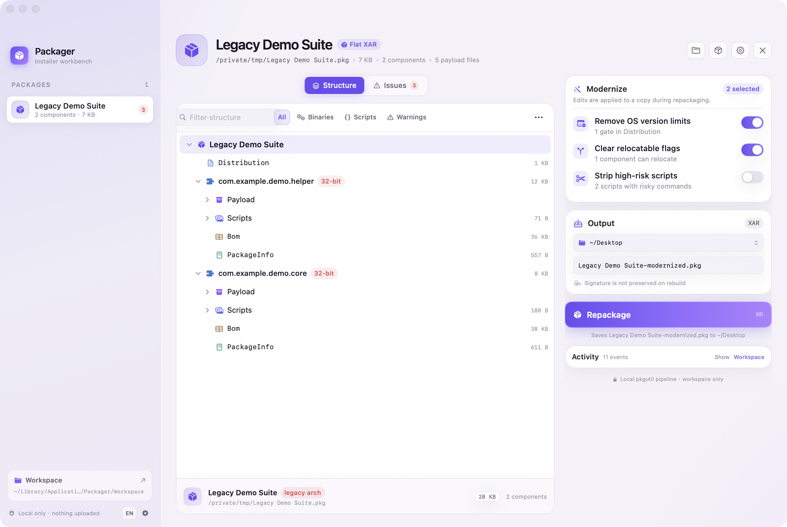
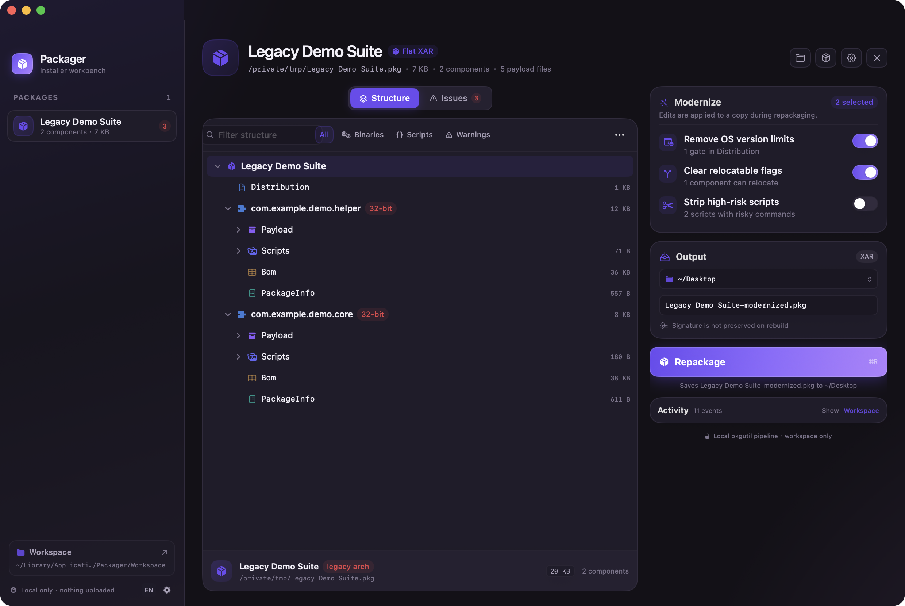
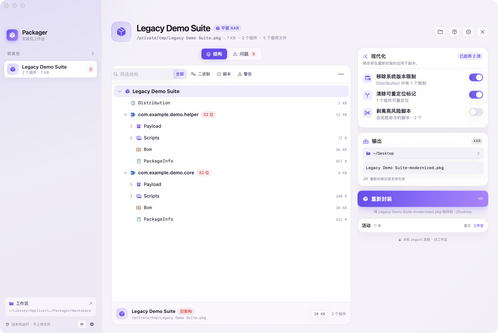
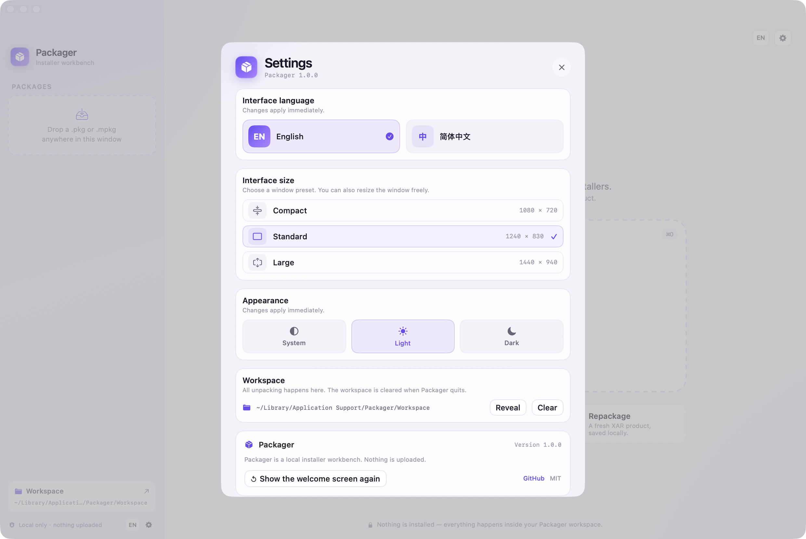

<h1 align="center">
  
  <br>
  Packager
</h1>

<h3 align="center">面向旧版 <code>.pkg</code> / <code>.mpkg</code> 安装包的本地 macOS 工作台。</h3>

<p align="center">
  <a href="./README.md">English</a> ·
  <a href="./README.zh-CN.md">Chinese</a>
</p>

<p align="center">
  <a href="https://github.com/Dirty-Octopus/packager/releases/latest"></a>
  
  
  
</p>

Packager 可以打开旧版 macOS 安装包，展示其中的组件、脚本与二进制，标出现代 macOS 已不再兼容的部分，并将修改后的内容重新封装为平面 XAR 安装包。所有操作都在临时工作区中完成，不会安装任何内容，不会上传文件，也不会写入系统目录。

无需账号，无遥测，不上传任何文件。

## 界面预览

| 浅色 | 深色 |
| --- | --- |
|  |  |



## 首次启动

首次启动时，Packager 会让你选择 English 或简体中文。之后可以随时通过齿轮图标或 <kbd>⌘</kbd><kbd>,</kbd> 修改界面语言、窗口尺寸预设与外观。

- 中文 / English，切换后立即生效，无需重启
- 紧凑 1080 × 720、标准 1240 × 830、大 1440 × 940
- 跟随系统 / 浅色 / 深色
- 窗口可从任意边缘自由缩放




## 功能

- 将平面 `.pkg` 或旧式 Bundle `.mpkg` 拖入窗口。
- 在工作区展开后，用树状结构展示产品、组件、Distribution、PackageInfo、Bom、安装脚本、载荷目录和单个 Mach-O 二进制。
- 检测 32 位 / PowerPC / 32 位 ARM 切片，包括“通用二进制中夹带旧切片”的情况。
- 检测 Distribution 中的系统版本限制（`min`、`max`、`allowed-os-versions` 及安装器 JavaScript 检查）。
- 检测可重定位组件与高风险安装脚本（递归删除、修改 Gatekeeper、`curl | sh`、常驻守护进程、SIP/固件写入等）。
- 对副本应用一项或多项现代化修改：
  - 移除系统版本限制
  - 清除可重定位标记
  - 剥离高风险脚本
- 调用系统 `pkgutil` 流程重新封装为现代 XAR 安装包，校验 Installer 可以读取，然后保存到你选择的目录。
- 在活动日志中显示实际执行的命令与进度。

Packager 只负责检测旧架构，不会凭空生成 64 位代码。重新封装无法让仅含 32 位代码的二进制在当前 macOS 上运行。

## 安装

从 [Releases 页面](https://github.com/Dirty-Octopus/packager/releases/latest) 下载最新的通用 DMG 或 ZIP。

1. 打开 DMG，将 `Packager.app` 拖入 `/Applications`；或解压 ZIP 后将 App 移动到该目录。
2. 如果 macOS 首次启动时阻止打开，请在终端中执行：

```bash
xattr -dr com.apple.quarantine /Applications/Packager.app
codesign --force --deep --sign - /Applications/Packager.app
open /Applications/Packager.app
```

由于本项目开源，开发者没有支付 Apple 每年 99 美元的开发者计划费用，安装后需要执行上面的命令。如果你有自己的 Developer ID 证书，也可以自行签名。

Release 使用 ad-hoc 签名，未经 Apple 公证。上面的命令会移除隔离标记并应用 ad-hoc 签名。此方式仅适合本机使用；ad-hoc 签名不能替代 Developer ID 签名与公证。

需要 macOS 14 或更高版本。Release 为通用二进制，同时支持 Apple Silicon 与 Intel Mac。

## 使用

1. 将 `.pkg` / `.mpkg` 拖入窗口，或按 <kbd>⌘</kbd><kbd>O</kbd>。安装包会被复制或展开到工作区，原始文件不会被修改。
2. 在「结构」中展开组件，查看载荷、脚本与二进制。旧架构切片会以红色标记。可使用筛选或搜索快速定位二进制、脚本或警告。
3. 在「问题」中查看检测到的版本限制与风险脚本。可以直接在问题卡片上启用修复，也可以在右侧选项中启用。
4. 在「现代化」中勾选需要的修改。所有修改都会在重新封装时应用到副本。
5. 选择输出目录与产品名称，点击「重新封装」。
6. 新生成的平面 XAR 安装包会经过校验后保存。点击「在 Finder 中显示」即可打开所在目录。

如果输出目录当前用户不可写，Packager 会通过 macOS 原生密码弹窗请求管理员授权。只有你确认后，相关命令才会以管理员权限执行。

## 实现方式

Packager 封装了 macOS 自带的系统工具：

- `pkgutil --expand` / `--expand-full`：在工作区检查安装包
- `pkgutil --flatten`：重新构建平面 XAR 产品
- `pkgutil --check-signature`：读取原始签名状态
- 一个轻量的 Mach-O 头部读取器：用于架构检测，不依赖逐文件调用 `lipo`

应用会直接解析 Distribution XML、`PackageInfo`（同时支持 property list 与 `pkg-info` 两种格式）、`Bom`、载荷与脚本；重建后的归档还会再次展开校验，之后才移动到输出目录。

工作区位于 `~/Library/Application Support/Packager/Workspace`，退出 Packager 时会自动清空。安装包内容不会被写入 `/`、`/System` 或 `/Library`；唯一的可选提权步骤是将成品复制到受保护目录。

## 常见问题

### 安装包会被上传吗？

不会。Packager 不发起网络请求，不收集遥测，也不会上传文件。它只是系统工具之上的本地图形界面。

### Packager 会安装或修改安装包吗？

不会。它只读取输入安装包，在工作区展开副本，并把新的产品写入输出目录。原始文件不会被修改。

### 需要管理员权限吗？

正常使用不需要。只有当你把成品保存到当前用户不可写的目录时，Packager 才会展示成品并调用 macOS 的密码弹窗授权一次，相关命令通过 `osascript` 以管理员权限执行。你可以取消。

### 重新封装会保留签名吗？

不会。重写归档会使原签名失效。新生成的安装包没有签名；如需分发，请使用自己的 Developer ID 重新签名并公证。

### 可以移除 32 位代码或补上 64 位切片吗？

不能。Packager 会检测并高亮旧架构切片；重新封装会保持载荷原样，不会改写二进制。

### 支持旧式 MPKG Bundle 吗？

支持。Bundle 形式的产品会按组件逐个展开，再重新构建为适用于现代 macOS 的平面 XAR 归档。

### macOS 提示 Packager 已损坏、无法打开或来自未知开发者

请执行[安装](#安装)中的命令。Release 使用 ad-hoc 签名，未经公证。

### 没有 Xcode 可以使用吗？

预编译的 App 可以直接使用。从源码构建需要带 SwiftUI 宏工具的 Xcode；仅有 Command Line Tools 不够。

## 开发

环境要求：

- macOS 14 或更高版本
- 带 SwiftUI 宏工具的 Xcode（已使用 Xcode 27.1 验证）

构建通用 App：

```bash
bash scripts/build.sh
```

安装本地构建到 `/Applications`（仅在需要时请求管理员权限）：

```bash
bash scripts/install.sh
```

生成包含 DMG、ZIP 和 SHA-256 校验和的通用 Release：

```bash
bash scripts/package_release.sh
```

产物会写入 `dist/`。

开发时也可以使用命令行检查模式：

```bash
.build/release/Packager --inspect "/path/to/package.pkg"
.build/release/Packager --inspect "/path/to/package.pkg" --rebuild /tmp/out --all
```

## 安全与隐私

- 无网络请求、无遥测、无账号、无上传。
- 所有解包与重新封装都在 `~/Library/Application Support/Packager/Workspace` 内完成。
- 输入安装包以只读方式打开。
- 仅当输出目录需要权限时才请求管理员授权，且只执行界面上展示的复制命令。
- App 使用 ad-hoc 签名。如需更强的信任链，请审查源码或自行构建。

## 致谢

- Apple 的 `pkgutil`、`pkgbuild`、`productbuild`、Installer 与 Mach-O 格式。
- SwiftUI 与 AppKit。
- 欢迎页、设置结构与安装须知参考 [Seal](https://github.com/Dirty-Octopus/seal)。
- README 结构参考 [Clash Verge Rev](https://github.com/clash-verge-rev/clash-verge-rev)。

Packager 与 Apple 无关联。

## 许可证

MIT，详见 [LICENSE](./LICENSE)。
