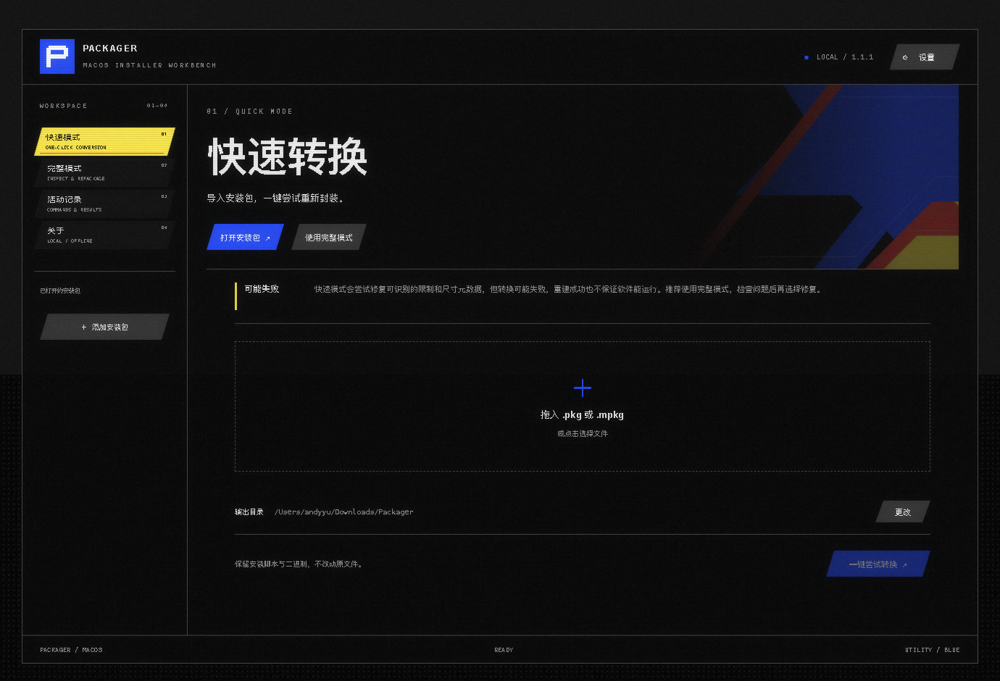
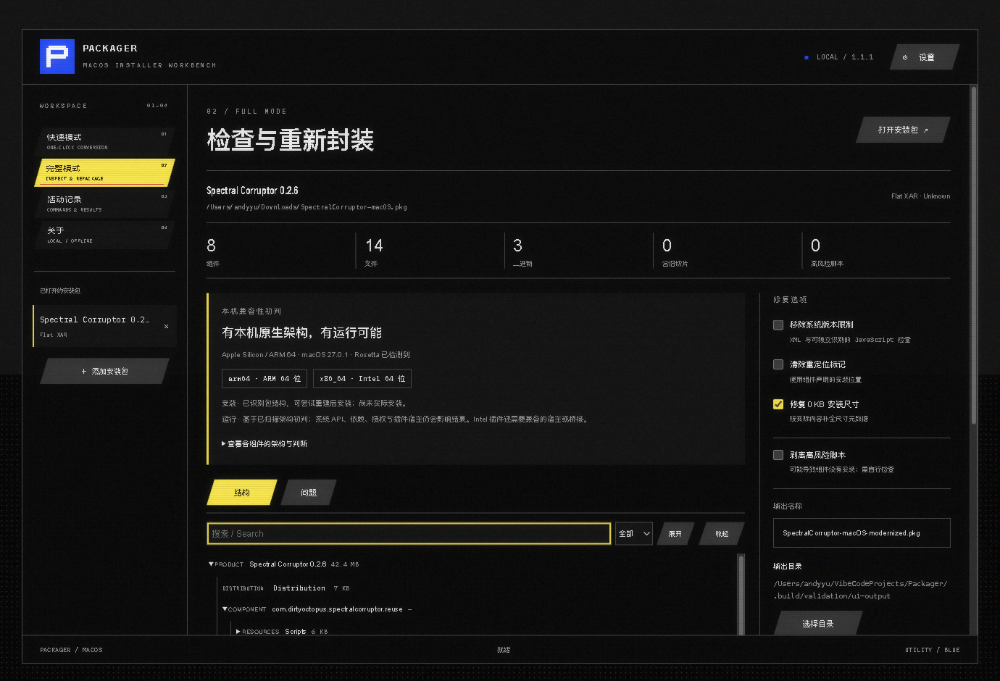
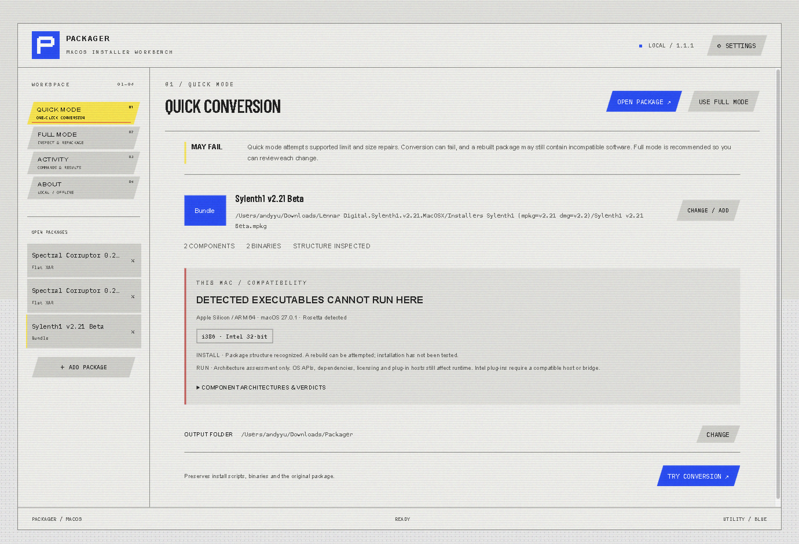

<h1 align="center"><br>Packager</h1>

面向旧版 macOS `.pkg` / `.mpkg` 安装包的本地工作台。检查结构、判断本机架构兼容性、按需修复后重新封装。

[English](README.md) · 简体中文 · MIT

当前源码版本为 **1.1.1**。界面使用 [AYMDevKitUI](https://github.com/Dirty-Octopus/AYMDevKitUI) 当前的 Electron 实现，图标类别为通用工具蓝色 `#164BFF`，界面沿用库自身的配色；安装包处理由独立 Swift 辅助程序完成。全部字体、界面音效和资产随 App 打包。



## 快速模式

启动时自动播放库原生的 2.5 秒构造入场，包含面板划入与非等比变形，之后进入快速模式。关闭界面动效或启用系统减少动态效果时直接进入。导入安装包后，点击「一键尝试转换」：

- 尝试移除支持的系统版本限制。
- 清除检测到的重定位标记。
- 修复含实际内容却显示为 0 KB 的安装尺寸元数据。
- 将支持的旧式 Bundle 转换为平面 XAR 安装包。
- 保留安装脚本和二进制，原文件不变；同名输出会自动编号。

**快速转换可能失败，归档验证通过也不保证安装或运行成功。推荐使用完整模式，检查具体问题后再选择修复。**

## 本机兼容性初判

快速模式与完整模式均显示本机 CPU、macOS 和 Rosetta 检测结果，并展示已识别二进制的位数与架构：Intel 的 i386 / x86_64、ARM 的 arm / arm64 / arm64_32、PowerPC 的 ppc / ppc64。通用二进制会列出各切片。

初判区分：有本机原生架构、可能通过 Rosetta 运行、需要 Rosetta、部分内容不兼容、检测到的程序无法运行、信息不足。可以展开查看每个组件的架构与结论。

- 安装与运行分别说明，不把重新封装当作兼容性保证。
- 只有旧切片与包含可用 64 位切片的通用二进制分别判断。
- 未展开完整载荷、扫描达到上限或没有识别到二进制时，不给出肯定运行结论。
- Intel 插件还受宿主架构和桥接支持影响。系统 API、依赖、授权和签名也可能阻止运行。
- 不安装 Rosetta，不转换机器码，不生成新的 64 位或 ARM 切片。

依据：[Apple 的 32 位兼容性说明](https://support.apple.com/103076)、[Rosetta 与 Intel 软件支持说明](https://support.apple.com/102527)。通用 Rosetta 支持按 Apple 公布的 macOS 27 及以前处理；macOS 28 的特定旧游戏例外无法由本工具静态确认。

## 完整模式



- 左侧切换已导入的安装包。
- 结构树展示 Distribution、PackageInfo、Bom、载荷、脚本和二进制；支持搜索、筛选、展开与只读文本预览。
- 问题面板按严重程度列出检测结果，并可切换对应修复。
- 分别选择版本限制、重定位、安装尺寸和高风险脚本处理。
- 高风险脚本检测使用文本启发式规则，可能误报或漏报；剥离脚本默认关闭，可能导致组件未安装。
- 活动记录展示检查、转换与验证事件。操作可取消；取消会终止对应的系统命令。

版本限制修复支持 XML 节点、根属性，以及能确认只检查系统版本的 JavaScript 安装谓词。混合硬件、文件或其他条件的检查会保留，并在重建结果中提示人工复核；不会执行安装包 JavaScript 来分析它。

设置在同一窗口中展开，支持中英文、跟随系统／浅色／深色、显示处理、CRT、柔化、动效与交互音效。按 `⌘,` 打开，Escape 关闭。按 `⌘O` 打开安装包，`⌘R` 按当前模式重新封装。



## 处理与验证范围

处理在 `~/Library/Application Support/Packager/Workspace/session-*` 的独立临时目录中完成，正常退出会清理当前会话。输入包不变，不运行安装脚本或载荷程序，不向系统安装其中的软件，也没有遥测或上传。

重建会从原文件重新展开，应用所选修改，经 `pkgutil --flatten` 生成 XAR，再次展开并核对组件身份后保存。此验证证明归档和组件元数据可读取，不证明真实安装、插件加载或音频播放正常。新包不保留原签名。

只有保存到受保护目录时才会展示具体复制命令，并通过 macOS 原生管理员授权保存成品。可以取消。

## 本地构建与安装

需要 macOS 14+、完整 Xcode、Node.js 22+ 和 npm。默认构建当前机器架构的 Electron App；Swift 辅助程序包含 arm64 与 x86_64。

```sh
bash scripts/build.sh
bash scripts/install.sh --no-build
```

App 位于 `dist/Packager.app`，安装到 `/Applications/Packager.app`。`ARCH=x64 bash scripts/build.sh` 可选择 Intel 目标，需取得对应的 Electron 运行时；此轮本地验收使用 Apple Silicon 目标。

产物采用 ad-hoc 签名，未经 Apple 公证。需要发布归档时运行 `bash scripts/package_release.sh`，生成 DMG、ZIP 和 SHA-256；该脚本不会提交或推送 Git。

## 开发与测试

```sh
DEVELOPER_DIR=/Applications/Xcode.app/Contents/Developer swift test
npm ci --prefix desktop
node scripts/prepare_electron.cjs
npm run build --prefix desktop
npm test --prefix desktop
npm run test:browser --prefix desktop
```

GUI 测试使用真实 Electron 窗口与 Swift IPC。设置 `PACKAGER_TEST_ORIGINAL`、`PACKAGER_TEST_FIXED`、`PACKAGER_TEST_LEGACY` 后，会选择本地样本，验证真实检查、快速重建、完整模式、架构初判与设置。测试只替换原生文件选择器的返回值，不模拟处理结果。可用 `PACKAGER_TEST_APP=/absolute/path/Packager.app/Contents/MacOS/Packager` 对打包后的 App 运行同一套测试。

命令行入口：

```sh
.build/backend/Packager --version
.build/backend/Packager --inspect /path/to/input.pkg
.build/backend/Packager --inspect /path/to/input.pkg --rebuild /path/to/output
```

三样本回归工具：

```sh
python3 scripts/validate_packages.py \
  --original /path/to/original.pkg \
  --fixed /path/to/fixed.pkg \
  --legacy /path/to/legacy.mpkg \
  --backend .build/backend/Packager \
  --output .build/validation/regression
```

它核对源文件不变、脚本与载荷字节保留、0 KB 修复、旧 Bundle 转换和 Installer 选项可读性，不执行安装。样本和重建产物不进入 Git。

源码结构与本轮验证见 [开发说明](docs/DEVELOPMENT.md)。AYMDevKitUI 的固定版本、接入方式与改动见 [来源记录](desktop/vendor/aym-devkit-ui/PROVENANCE.md)。
